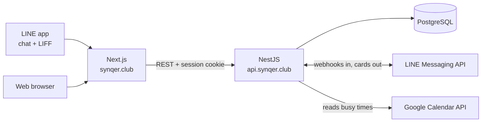

# Synqer

Group scheduling that never leaves the chat. Start an event from a LINE group,
everyone paints their free hours onto a shared grid, and the host locks in the
slot that works — without anybody installing an app or creating an account.

**[synqer.club](https://synqer.club)**

## How it works



The two clients are the same Next.js app: LIFF renders it in an in-app browser
that is already authenticated, and a normal browser gets the same routes behind
a login page.

## Tech stack

| Layer | What we use |
| --- | --- |
| Frontend | Next.js 16 (App Router, React 19), Tailwind CSS v4, Radix UI, TanStack Query, next-intl |
| Backend | NestJS 11, Prisma 6, express-session |
| Database | PostgreSQL — Docker locally, [Neon](https://neon.tech) in production |
| Integrations | LINE Login, LIFF, LINE Messaging API, Google OAuth, Google Calendar API |
| Infrastructure | Docker, Cloud Run, Artifact Registry, GitHub Actions |

## Repository layout

| Path | What's in it |
| --- | --- |
| [`frontend/`](frontend) | The Next.js app, and the LIFF view — see [frontend/README.md](frontend/README.md) |
| [`backend/`](backend) | The NestJS API and the Prisma schema — see [backend/README.md](backend/README.md) |
| [`nginx.conf`](nginx.conf), [`run-nginx.sh`](run-nginx.sh) | Local reverse proxy putting both dev servers on one origin |
| [`.github/workflows/`](.github/workflows) | Pull request checks, and the deploy to Cloud Run |

## Running it locally

Local development does not run on `localhost`. LIFF and the session cookie both
require a single HTTPS origin, and LINE has to be able to reach your webhook
from the outside, so requests arrive through a tunnel and an nginx proxy that
merges the two dev servers:

```
LINE / browser  ->  https tunnel  ->  nginx :8088  ->  Next :3000
                                                   ->  Nest :8080  (/api)
```

see [`nginx.conf`](nginx.conf).

### Prerequisites

- Node 20 and Docker
- An HTTPS tunnel to `localhost:8088` — we use Cloudflare Tunnel, ngrok works too
- Your own Google OAuth client, LINE Login channel with a LIFF app, and LINE
  Messaging API channel. [`backend/.env.example`](backend/.env.example) lists
  which value comes from where, and why the channels can't be shared between
  developers.

### Setup

```bash
cp backend/.env.example backend/.env
cp frontend/.env.example frontend/.env
npm --prefix backend install
npm --prefix frontend install
```

Fill in both `.env` files before going further — the comments in the examples
say what each variable is for. Every redirect URI has to use your tunnel host,
never `localhost`.

Then bring up the database and create the schema:

```bash
npm --prefix backend run db:up
cd backend && npx prisma migrate dev
```

Prisma reads `backend/.env`, so that second command has to run from `backend/`
rather than the repository root.

### Every session

Four processes, one per terminal:

| Process | Command |
| --- | --- |
| Backend | `npm --prefix backend run start:dev` |
| Frontend | `npm --prefix frontend run dev` |
| Proxy | `./run-nginx.sh` |
| Tunnel | `cloudflared tunnel run --token <token>` |

Then open your tunnel URL. Opening `localhost:3000` directly will look like it
works and then fail on the first API call, because CORS and the session cookie
are both bound to the tunnel host.

## The API contract

The API types are generated, not hand-written. Nest emits
`backend/openapi/openapi.json` from its controllers and DTOs, and the frontend
turns that into `frontend/generated/openapi.ts`. Both files are committed, and
CI fails if either is out of date. After changing a controller or a DTO:

```bash
npm --prefix backend run openapi:generate
npm --prefix frontend run api:gen
```

## Deployment

Merging a pull request into `main` runs
[`deploy-to-gcp.yml`](.github/workflows/deploy-to-gcp.yml): migrate Neon, build
and push both images to Artifact Registry, then deploy each to Cloud Run. The
frontend serves `synqer.club` and the backend `api.synqer.club`.
