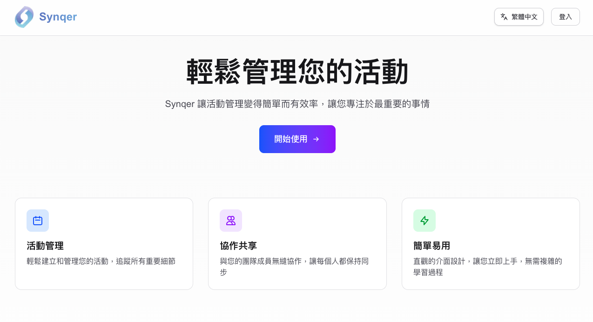
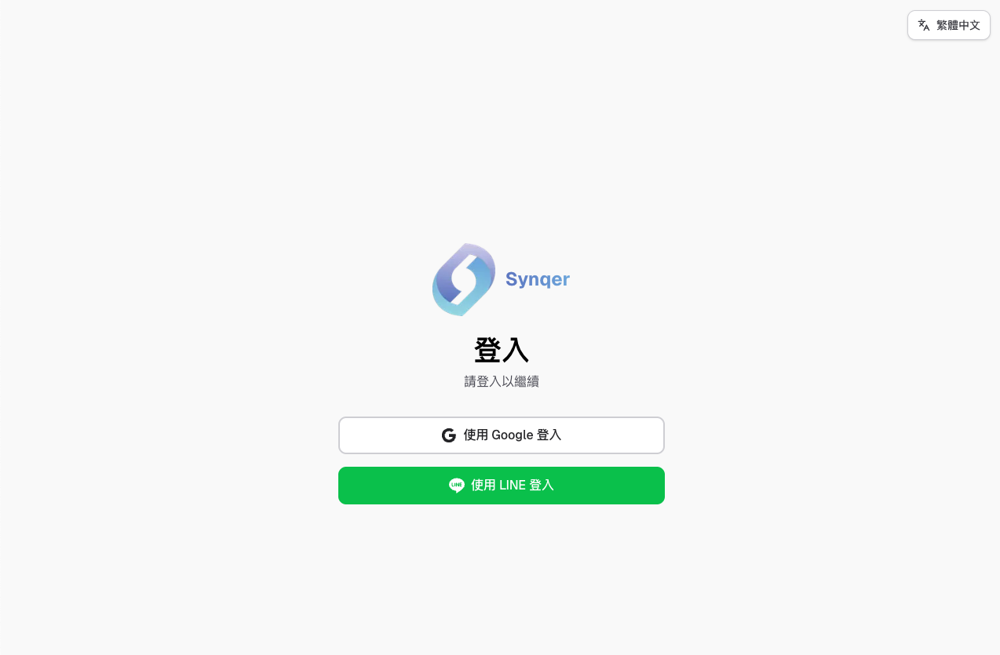
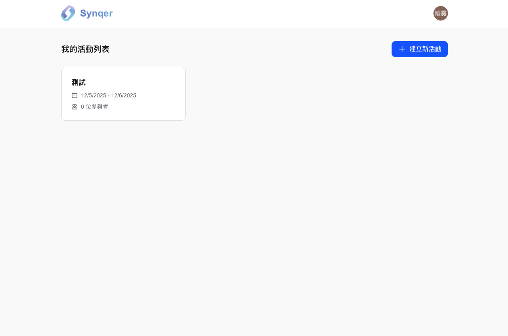

# Final Project – Midterm Plan

## Deploy Link
https://synqer.club

## 1. 本次 Prototype 已完成
- 登入 Auth（Google, Line）
- 資料庫串接 (Neon)
- 自動容器化部署
    - 使用 Docker 進行容器化
    - 使用 Google Artifact Registry 存 Image
    - 使用 Google Cloud Run 部署在 GCP
    - 使用 Github Action 自動在 merge 到 main branch 時部署

- 基本功能：

    0. 網站主畫面與登入頁面

    1. 網站登入畫面

    2. 登入後煮頁面 dashboar

## 2. 最終版本預計完成項目
- 與 LINE 群組有更好的整合
- 與 Google Calendar 有更好的整合
- 活動創建者可以對活動有更多詳細的設定，例如：
    1. 權限管理：選擇可以投票的人員
    2. 設置提醒：提醒還沒投票的成員投票
    3. 日期篩選：讓主辦方可以快速篩選出適合的日期
- 活動參與者可以有更方便的投票方式，例如：
    1. yes/no：使用者可以有兩種方式投票，一種是表達自己可以的時間，一種是表達自己不行的時間。
    2. selection：讓使用者可以輕鬆用滑動（拖曳）的方式選擇 可以/無法 參加的時間。
    3. Google Calendar：可以 import calendar 並一鍵選出自己無法參與的時間。
- 後台查看使用者相關數據。
    

## 3. 預期開發進度
12 月的預期開發進度：
- Week 1: 完成 LINE 群組與 Google Calendar API 的整合，後台的建立。
- Week 2: 完成「活動創建者可以對活動有更多詳細的設定」
- Week 3: 完成「活動參與者可以有更方便的投票方式」
- Week 4: 邀請真人使用者加入，根據真實使用者回饋持續優化產品。
